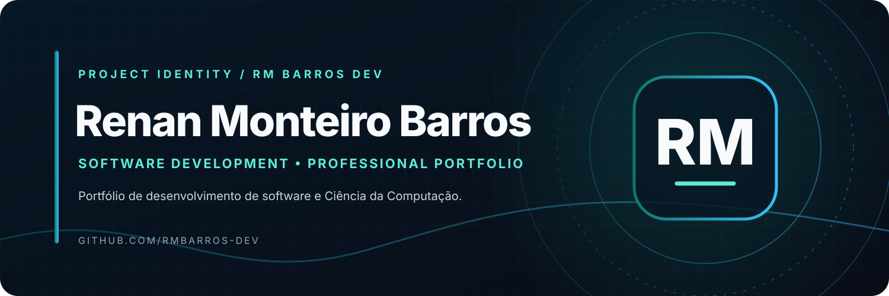
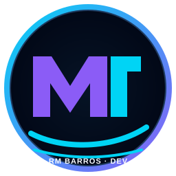
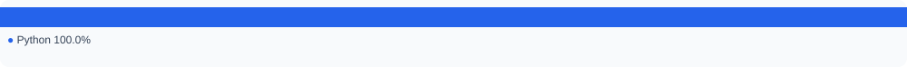

<!-- English is the primary language of this profile. Spanish and Brazilian Portuguese versions are available below. -->

  <strong>Languages:</strong>
  <a href="README.md">English</a> ·
  <a href="README.es.md">Español</a> ·
  <a href="README.pt-BR.md">Português (Brasil)</a>

  
   
  
  <h1>Renan Monteiro Barros</h1>
  <h3>Computer Science Student · Software Development · Full-Stack Engineering</h3>
  

    <a href="https://github.com/RMBarros-Dev">GitHub</a> ·
    <a href="mailto:cienciadacomputacaorenan@gmail.com">Email</a>
  

  

    
    
    
  

---

## 01 · About Me

I am **Renan Monteiro Barros**, an undergraduate Computer Science student at **Universidade Cruzeiro do Sul**, focused on building a strong foundation in software development and engineering.

My main technical direction is **Full-Stack Development and Software Engineering**, with an interest in backend systems, APIs, web applications, databases, system integration and software quality. I use academic, personal and experimental projects to practise problem analysis, implementation, documentation and technical decision-making.

I value clear requirements, maintainable code, proportionate architecture, secure configuration, testability, accessibility and honest technical documentation. I distinguish implemented functionality from planned improvements, and learning activities from professional experience.

## 02 · Academic Summary

  
  
  

The complementary education catalogue contains **44 education records** with a combined **2,109 nominal hours**, based on workloads stated by the respective institutions or learning platforms. The catalogue includes certificates, participation statements and learning tracks; these document types are not interchangeable.

  

  

**Measurement note:** nominal workload is not professional experience, unique net study time, a proficiency score or a certification level. See the [complementary education catalogue](docs/certifications.en.md) for the detailed records and accounting criteria.

### Languages and technologies in my learning path

  
  
  
  

| Group | Technologies | Count |
|---|---|---:|
| Programming and scripting | Python, C, C++, C#, Java, JavaScript, TypeScript, PHP, Go, Kotlin, Dart, Swift, Rust, Bash | **14** |
| Markup and styling | HTML, CSS | **2** |
| Query | SQL | **1** |
| **Total** | **17 distinct technologies** | **17** |

These figures represent technologies I have studied or used, based on my learning history. They are not usage frequency, proficiency levels, professional experience, or a measure of how much code exists in my repositories. The repository-level language statistics will be measured separately from each repository's source code.

## 03 · Academic Vision

My academic vision is to connect computer science fundamentals with practical engineering. I aim to improve my ability to understand problems, model solutions, justify technical choices, build maintainable applications and verify system behaviour.

Current learning directions:
- Software Engineering, algorithms and programming fundamentals.
- Full-Stack application development and API design.
- Database modelling, persistence and data management.
- Software architecture, testing and continuous integration.
- Application security, infrastructure and cloud fundamentals.
- Data Science and Artificial Intelligence foundations, including machine-learning types, algorithm and technique selection, and predictive-solution development with R and Python (Enap course syllabus).
- UX, accessibility, internationalisation and localisation.

These are development priorities, not claims of mastery or completed implementation in every area.

## 04 · Projects Grid

The portfolio below highlights academic, personal and experimental work. Each repository is the source of truth for its implementation, dependencies, setup instructions and current status.

<table>
  <tr>
    <td width="50%" valign="top">
      <h3><a href="https://github.com/RMBarros-Dev/Hydra-Digital-Shop">Hydra Digital Shop</a></h3>
      
<strong>Full-Stack commerce demonstrator</strong>

      
Study project combining an ASP.NET Core backend, React/TypeScript interface and .NET Aspire orchestration.

      
  

      
<em>Scope note: demonstrative checkout; no real payment-provider integration.</em>

    </td>
    <td width="50%" valign="top">
      <h3><a href="https://github.com/RMBarros-Dev/Olokuti-Digital">Olokuti Digital</a></h3>
      
<strong>Academic MVP · Product and operations</strong>

      
Application concept for centralising product information, inventory context and operational activities.

      
  

      
<em>Scope note: academic and experimental MVP, not a production business system.</em>

    </td>
  </tr>
  <tr>
    <td width="50%" valign="top">
      <h3><a href="https://github.com/RMBarros-Dev/Api-Connect">Api-Connect</a></h3>
      
<strong>Backend and API laboratory</strong>

      
Separate Node.js/Express and .NET tracks for practising HTTP endpoints, API organisation and integration concepts.

      
  

      
<em>Scope note: the Express track uses in-memory storage and has no authentication or authorisation.</em>

    </td>
    <td width="50%" valign="top">
      <h3><a href="https://github.com/RMBarros-Dev/instituto-nova-esperanca">Instituto Nova Esperança</a></h3>
      
<strong>Multilingual website · PWA</strong>

      
Institutional web experience with localised content, responsive interfaces and progressive web application resources.

      
  

      
<em>Scope note: accessibility checks are not a formal WCAG certification.</em>

    </td>
  </tr>
  <tr>
    <td width="50%" valign="top">
      <h3><a href="https://github.com/RMBarros-Dev/Sistema-Bancario">Sistema Bancário</a></h3>
      
<strong>Banking logic simulation</strong>

      
Educational C# project focused on operations, business rules, input handling and persistence fundamentals.

      
 

    </td>
    <td width="50%" valign="top">
      <h3><a href="https://github.com/RMBarros-Dev/Jogo-da-Adivinha-o">Jogo da Adivinhação</a></h3>
      
<strong>Programming fundamentals</strong>

      
Console application for practising logic, conditional flow, input validation and basic interaction.

      
 

    </td>
  </tr>
</table>

## 05 · Badges, Tags & Language Logos

Technology logos identify tools and languages present in my learning path or repositories. They do not represent a proficiency ranking, certification or claim that every technology is used in every project.

### Programming and Web languages

  
  
  
  
  
  
  

### Frameworks, databases and engineering tools

  
  
  
  
  
  
  
  
  

Additional languages studied or used include C, C++, Java, PHP, Go, Kotlin, Dart, Swift, Rust and Bash. Their mention records learning exposure, not equal depth or current use across the portfolio.

## 06 · Methodology

My working methodology is based on explicit engineering principles:

| Principle | Practical meaning |
|---|---|
| Requirements First | Understand users, problem, constraints and acceptance criteria before implementation. |
| KISS | Prefer the simplest solution that adequately addresses the problem. |
| YAGNI | Avoid speculative features and unnecessary abstractions. |
| Separation of Concerns | Keep responsibilities and boundaries clear. |
| SOLID | Apply object-oriented design principles when they improve cohesion and maintainability. |
| Security by Design | Consider validation, access control, secrets and data exposure early. |
| Testability | Design behaviour so that important paths can be verified. |
| Documentation as Code | Keep setup, decisions, limitations and operational guidance versioned. |
| Incremental Delivery | Deliver in small, reviewable and verifiable changes. |

## 07 · Structure, Architecture & Version Control

Architecture is selected according to requirements, complexity and project constraints—not by fashion.

- **Project structure:** organise modules by responsibility and domain.
- **Application architecture:** separate presentation, application logic, domain rules, integrations and persistence where justified.
- **Data architecture:** document entities, relationships, constraints and migration strategy.
- **Configuration:** keep environment-specific values outside source code and protect credentials.
- **Version control:** use Git for traceable changes and GitHub for repository collaboration, reviews and publication.
- **Change management:** prefer focused commits, clear descriptions and reviewable pull requests.
- **Technical documentation:** record setup, architecture decisions, dependencies, known limitations and status.

Repository-level documentation defines the actual architecture and workflow of each project. A proposed architecture is not represented as a deployed system.

## 08 · Automation, Testing & Applications

Automation and testing support repeatability and confidence in changes. Their presence and coverage vary by repository.

| Area | Tools / practices | Purpose |
|---|---|---|
| Unit and application tests | xUnit, pytest | Verify defined behaviours and rules. |
| Static analysis | Ruff and stack-specific analyzers | Detect selected quality and consistency issues. |
| Continuous Integration | GitHub Actions | Automate checks and repository workflows. |
| Security analysis | CodeQL where configured | Identify selected code security patterns. |
| Build and orchestration | .NET Aspire and project scripts | Support local development and service coordination. |
| Web delivery | Build scripts and PWA resources | Build and validate web assets. |

A workflow file or badge alone does not guarantee that all tests currently pass. Live execution results belong to the repository's Actions history.

## 09 · Technologies, Security & Governance

Security, privacy and governance are engineering responsibilities throughout the software lifecycle.

- Input validation and deliberate error handling.
- Authentication and authorisation as separate concerns.
- Least-privilege access for users, services and credentials.
- Secret protection through environment configuration and suitable secret stores.
- Data minimisation and careful handling of personal or sensitive information.
- Dependency, runtime and configuration maintenance.
- Logs that support diagnosis without exposing secrets.
- Documentation of risks, limitations and security assumptions.

My complementary studies include information security, secure coding, cybersecurity, endpoint security, computer forensics, data protection, IT governance, COBIT and ITIL. The Cisco Networking Academy Endpoint Security course lists antimalware protection, system and endpoint protection, defending systems and devices, application security, host-based intrusion prevention, mitigation of common network attacks, wireless and mobile device attacks, common cyber threats, Windows Security, Linux basics, IP/TCP/UDP vulnerabilities, network security infrastructure and securing WLANs. These are documented learning topics, not proof of professional experience or mastery.

## 10 · Tables, Charts & Statistics

### Complementary education by knowledge area

| Knowledge area | Records | Nominal hours |
|---|---:|---:|
| Software Development and Engineering | 8 | 340 h |
| Infrastructure, Networks and Cloud | 5 | 514 h |
| Cybersecurity, Forensics and IT Governance | 9 | 443 h |
| Data, Data Science and Artificial Intelligence | 10 | 338 h |
| Management, Business and Digital Transformation | 4 | 257 h |
| UX, Design and Interactive Applications | 7 | 204 h |
| Digital Research and Information Literacy | 1 | 13 h |
| **Total** | **44** | **2,109 h** |

### Complementary education by institution

| Institution / provider | Records | Nominal hours |
|---|---:|---:|
| Universidade Cruzeiro do Sul (including Cruzeiro do Sul Virtual) | 14 | 1,520 h |
| FGV Online | 17 | 222 h |
| Cisco Networking Academy / UNICSUL and SENAI-SC/LAB365 | 7 | 193 h |
| Escola Nacional de Administração Pública (Enap) | 6 | 174 h |
| **Total** | **44** | **2,109 h** |

**Statistics criteria:** each record is assigned to one primary knowledge area for this summary. Hours are nominal workloads transcribed from the education catalogue; classifications are editorial and do not measure competence. See the [detailed catalogue](docs/certifications.en.md).

## 11 · University Academic Education

### Bachelor's Degree in Computer Science
**Universidade Cruzeiro do Sul · Undergraduate studies in progress**

This degree is the formal academic foundation of my development in computing. The programme's current subjects, completed credits and academic progress should be verified through the official academic record; this profile does not infer completed coursework or graduation.

[Universidade Cruzeiro do Sul — Computer Science](https://cursos.cruzeirodosul.edu.br/grad-ciencia-da-computacao-cruzeiro-do-sul/p)

## 12 · Complementary Academic Education

The complementary catalogue currently documents **44 records and 2,109 nominal hours** from Universidade Cruzeiro do Sul / Cruzeiro do Sul Virtual, FGV Online, Cisco Networking Academy / UNICSUL, SENAI-SC/LAB365 and Enap.

Study themes include:
- Software development, programming, Python, Git, web technologies and agile methods.
- Network and server administration, networking and cloud computing.
- Information security, secure coding, cybersecurity, forensics and data protection.
- Data management, SQL, Data Science, Machine Learning, predictive analytics, R, Python and AI-related topics.
- Business, governance, management and digital transformation.
- UX, design, digital content and instructional design.
- Digital research and information literacy.

**Latest addition — Enap:** *Soluções Preditivas Baseadas em Dados com o Uso do R e do Python* (25 h, final grade 100; 19 Nov 2026). Its documented syllabus covers machine-learning types, technique and algorithm selection, and predictive-solution development.

The catalogue distinguishes certificates, participation statements and learning tracks. Consult [Complementary Education Records](docs/certifications.en.md) for the itemised list, stated workloads and source notes.

## 13 · Improvement Roadmap

The following points are learning and improvement priorities—not claims of completed certifications or production capabilities.

| Development axis | Improvement direction |
|---|---|
| Computer Science foundations | Strengthen algorithms, data structures, complexity and problem-solving. |
| Software Engineering | Improve requirements analysis, domain modelling, design and maintainability. |
| Full-Stack development | Build complete applications with clear frontend/backend contracts. |
| Architecture and APIs | Deepen API design, integration patterns, resilience and observability. |
| Databases | Improve relational modelling, transactions, indexing and query performance. |
| Quality engineering | Expand automated tests, CI checks and regression prevention. |
| Security | Practise threat modelling, secure coding and privacy-aware design. |
| Cloud and infrastructure | Improve deployment, configuration, monitoring and operational fundamentals. |
| Data and AI | Develop data literacy, evaluation methods and responsible AI foundations. |
| Accessibility and localisation | Improve inclusive interfaces, internationalisation and regional adaptation. |

## 14 · Acknowledgements

I acknowledge the educators, institutions, open-source maintainers, technical communities and contributors whose work supports continuous learning and the development of this portfolio.

Special thanks to **Universidade Cruzeiro do Sul**, the complementary education providers listed in the catalogue, and everyone who shares knowledge, reviews code and encourages responsible software development.

---

  Built with curiosity, engineering discipline and continuous learning.

## Engineering Metrics

  
  
  

This repository is a developer-profile and documentation portfolio. Its language distribution reflects the repository's tracked files, not the languages used across every project listed in the profile.

<!-- REPOSITORY_METRICS_START -->
### Language distribution (GitHub Linguist)

| Language | Source bytes | Share |
|---|---:|---:|
| Python | 3,097 | 100.00% |

_Total measured source bytes: 3,097. Refreshed: 2026-11-18 21:11 UTC._

<!-- REPOSITORY_METRICS_END -->

### Technical verification

| Dimension | Evidence / scope | Interpretation |
|---|---|---|
| Source composition | GitHub Linguist API | Tracks languages in this repository only. |
| Documentation | Markdown files and repository assets | Documentation presence is not a software test result. |
| Visual assets | Versioned SVG files | Asset existence does not establish visual accessibility. |
| Automation | [Repository metrics workflow](.github/workflows/repository-metrics.yml) | Refreshes language statistics daily and on pushes. |
| CI / test coverage | No application test suite declared for this profile repository | Not reported as a quality score. |
| Security analysis | No CodeQL result represented here | Absence of a badge is not a security assessment. |

