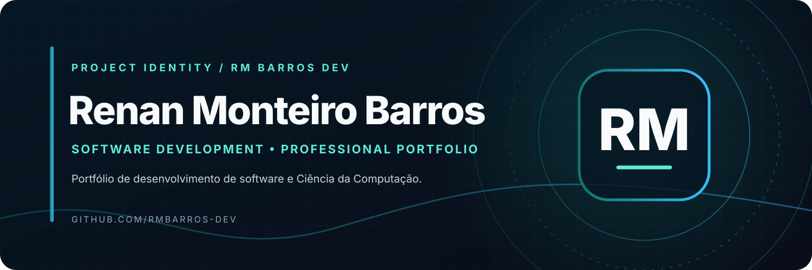
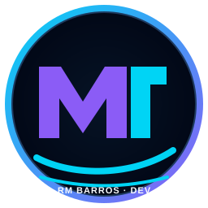
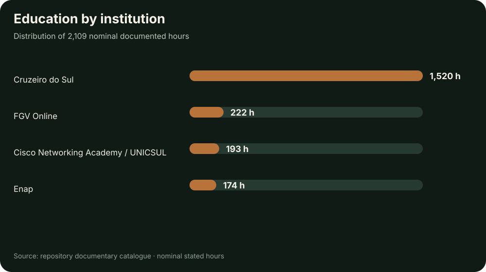

<!--
Perfil profesional y académico.
Actualiza este documento únicamente cuando la formación, los proyectos o las competencias puedan verificarse.
-->

  <strong>Idiomas:</strong>
  <a href="README.md">English</a> ·
  <a href="README.es.md">Español</a> ·
  <a href="README.pt-BR.md">Português (Brasil)</a>

  
   
  
  <h1>Renan Monteiro Barros</h1>
  <h3>Ciencias de la Computación · Desarrollo de Software · Ingeniería Full Stack</h3>
  
<a href="https://github.com/RMBarros-Dev">GitHub</a> · <a href="mailto:cienciadacomputacaorenan@gmail.com">Correo electrónico</a>

  

    
    
  

---

## 01 · Sobre mí

Soy estudiante de **Ciencias de la Computación en la Universidade Cruzeiro do Sul**, en proceso de formación como desarrollador de software. Mi orientación principal es la **Ingeniería de Software y el Desarrollo Full Stack**, con interés en aplicaciones Web, servicios backend, APIs, integración de sistemas y persistencia de datos.

Desarrollo proyectos académicos, personales y experimentales para convertir fundamentos de computación en soluciones ejecutables y documentadas. También tengo interés en ciberseguridad, infraestructura, ciencia de datos, inteligencia artificial, UX y tecnologías para la transformación digital.

Mi enfoque prioriza la comprensión del problema, requisitos explícitos, arquitectura proporcional a la necesidad, separación de responsabilidades, seguridad desde el diseño, pruebas y documentación. También registro las limitaciones de cada solución para no presentar prototipos como productos operativos ni estudios como experiencia profesional.

> **Alcance del perfil:** esta página distingue implementaciones publicadas, tecnologías identificadas en los repositorios, formación documentada y objetivos de aprendizaje. Mencionar una tecnología o área no implica dominio avanzado, certificación profesional ni experiencia laboral.

## 02 · Resumen académico

  
  
  

Los indicadores resumen los registros documentales incluidos en el catálogo de formación complementaria. La carga horaria es la suma de las horas declaradas por las instituciones o plataformas; no representa experiencia profesional, nivel de competencia, tiempo neto único de estudio ni equivalencia entre cursos y rutas formativas.

**Metodología de cómputo:** cada registro se asigna a una sola área para evitar duplicaciones en el resumen. La clasificación es editorial y se basa en los títulos y contenidos documentados; no mide competencia técnica. Se mantiene la distinción documental entre certificados, constancias de participación y rutas de aprendizaje. Consulta el [catálogo completo](docs/certifications.en.md) para ver instituciones, fechas, cargas horarias y criterios documentales.

## 03 · Visión académica

Mi orientación académica conecta los fundamentos de la computación con la práctica de la ingeniería de software. El objetivo es desarrollar la capacidad de analizar requisitos, justificar decisiones técnicas, implementar sistemas mantenibles y validar su comportamiento.

Las prioridades actuales de aprendizaje son:
- Ingeniería de software y desarrollo de aplicaciones Full Stack.
- Arquitectura backend, diseño de APIs e integración de sistemas.
- Bases de datos, modelado de datos y persistencia.
- Calidad de software, pruebas automatizadas e integración continua.
- Seguridad de aplicaciones, infraestructura y fundamentos de cloud.
- Fundamentos de ciencia de datos e IA, con uso y evaluación responsables.
- UX, accesibilidad y experiencias digitales multilingües.

Son objetivos de estudio y mejora, no afirmaciones de que todos estos temas ya estén implementados en el portafolio.

## 04 · Proyectos en cuadrícula

Los proyectos se presentan según su propósito, con tecnologías y limitaciones explícitas. Consulta cada repositorio para conocer detalles de implementación, versiones, instrucciones de instalación y estado actual.

<table>
  <tr>
    <td width="50%" valign="top">
      <h3><a href="https://github.com/RMBarros-Dev/Hydra-Digital-Shop">Hydra Digital Shop</a></h3>
      
<strong>Demostración Full Stack · Comercio digital</strong>

      
Proyecto de estudio que integra una API ASP.NET Core, interfaz React/TypeScript y orquestación local con .NET Aspire.

      
  

      
<strong>Límite:</strong> checkout demostrativo, sin integración con un proveedor de pagos real.

    </td>
    <td width="50%" valign="top">
      <h3><a href="https://github.com/RMBarros-Dev/Olokuti-Digital">Olokuti Digital</a></h3>
      
<strong>MVP académico · Catálogo y operaciones</strong>

      
Concepto de aplicación Django para explorar la centralización de información de productos, tareas operativas, informes y eventos de auditoría.

      
  

      
<strong>Límite:</strong> MVP académico y experimental; no es un sistema oficial de la empresa ni un despliegue de producción.

    </td>
  </tr>
  <tr>
    <td width="50%" valign="top">
      <h3><a href="https://github.com/RMBarros-Dev/Api-Connect">Api-Connect</a></h3>
      
<strong>Laboratorio de APIs · Backend</strong>

      
Rutas independientes en Node.js/Express y .NET para estudiar rutas HTTP, organización backend, contratos e integración.

      
  

      
<strong>Límite:</strong> la ruta Express utiliza almacenamiento en memoria y no implementa autenticación ni autorización.

    </td>
    <td width="50%" valign="top">
      <h3><a href="https://github.com/RMBarros-Dev/instituto-nova-esperanca">Instituto Nova Esperança</a></h3>
      
<strong>Plataforma Web multilingüe · PWA</strong>

      
Portal institucional multipágina con contenido localizado, recursos de aplicación Web progresiva y flujos de calidad.

      
  

      
<strong>Límite:</strong> las comprobaciones heurísticas de accesibilidad no constituyen una certificación WCAG.

    </td>
  </tr>
</table>

### Proyectos de fundamentos

| Repositorio | Alcance | Tecnologías |
|---|---|---|
| [Sistema Bancário](https://github.com/RMBarros-Dev/Sistema-Bancario) | Simulación de operaciones bancarias, reglas de dominio, precisión monetaria decimal y persistencia local. | C# · .NET · xUnit |
| [Jogo da Adivinhação](https://github.com/RMBarros-Dev/Jogo-da-Adivinha-o) | Lógica de programación, validación de entradas, reglas de juego y flujo verificable. | C# · .NET |

## 05 · Badges, etiquetas y logotipos de lenguajes

Los distintivos identifican tecnologías relacionadas con el portafolio. No representan niveles de dominio ni significan que todas las herramientas se utilicen en todos los repositorios.

### Lenguajes

  
  
  
  
  
  
  

### Frameworks, plataformas y herramientas

| Categoría | Tecnologías identificadas | Contexto en el portafolio |
|---|---|---|
| Backend Python | Django | Olokuti Digital |
| Backend .NET | C#, .NET, ASP.NET Core | Hydra Digital Shop, Api-Connect y proyectos de fundamentos |
| Backend JavaScript | Node.js, Express | Api-Connect |
| Frontend | React, TypeScript, Vite | Hydra Digital Shop |
| Interfaz y estilos | HTML, CSS, Bootstrap, HTMX, Tailwind CSS | Proyectos Web correspondientes |
| Persistencia | PostgreSQL, SQL Server, SQLite / almacenamiento local según el proyecto | Aplicaciones y laboratorios |
| Orquestación | .NET Aspire | Hydra Digital Shop y Api-Connect |
| Calidad | xUnit, pytest, Ruff, CI y CodeQL, según los repositorios | Pruebas y automatización en proyectos correspondientes |
| Control de versiones | Git y GitHub | Organización y publicación del portafolio |
| Infraestructura de proyecto | Supabase y Railway | Arquitectura documentada de Olokuti Digital |

Una tecnología descrita como infraestructura planificada no debe interpretarse automáticamente como una integración activa en producción. Consulta cada README para verificar versiones, dependencias y estado de implementación.

## 06 · Metodología

Los siguientes principios orientan las decisiones técnicas. Son criterios de trabajo, no una afirmación de que todos los repositorios implementen íntegramente cada práctica.

| Principio | Aplicación |
|---|---|
| Requirements First | Comprender el problema, los usuarios, las reglas y las restricciones antes de elegir herramientas. |
| KISS | Preferir soluciones simples y legibles; evitar abstracciones sin beneficio demostrado. |
| YAGNI | No anticipar funcionalidades sin requisitos o justificación en el alcance. |
| Separation of Concerns | Delimitar interfaz, aplicación, dominio, integración y persistencia. |
| Security by Design | Considerar autenticación, autorización, validación, secretos y exposición de datos desde el diseño. |
| Testability | Crear componentes y flujos verificables mediante pruebas proporcionales al riesgo. |
| Observability | Utilizar registros y señales de salud útiles sin exponer información sensible. |
| Documentation as Code | Mantener instrucciones, decisiones, limitaciones y arquitectura junto al código. |
| Incremental Delivery | Evolucionar mediante etapas pequeñas y verificables. |

Los criterios de calidad incluyen legibilidad, mantenibilidad, configuración segura, compatibilidad, reproducibilidad, trazabilidad y honestidad técnica.

## 07 · Estructura, arquitectura y control de versiones

Mi enfoque arquitectónico comienza por los requisitos y las restricciones del proyecto. Busco mantener responsabilidades explícitas y una complejidad proporcional al problema.

- **Estructura:** organizar el código por responsabilidad y dominio, evitando acoplamiento innecesario.
- **Arquitectura:** separar interfaz, lógica de aplicación, reglas de dominio, integraciones y persistencia cuando el alcance lo justifique.
- **Configuración:** mantener los ajustes específicos de cada entorno fuera del código fuente y proteger las credenciales.
- **Datos:** documentar esquemas, supuestos de persistencia y requisitos de migración.
- **Control de versiones:** utilizar Git y GitHub para rastrear cambios, revisar el historial y registrar decisiones.
- **Documentación:** mantener instrucciones de instalación, notas de arquitectura, limitaciones y estado del proyecto.

Las convenciones específicas de cada repositorio están documentadas en sus README y archivos de ingeniería. Los diseños planificados no se presentan como despliegues completados.

## 08 · Automatización, pruebas y aplicaciones

La automatización y las pruebas se aplican según la tecnología y la madurez de cada proyecto.

| Área | Herramientas o prácticas identificadas | Finalidad |
|---|---|---|
| Pruebas automatizadas | xUnit, pytest | Verificar reglas de negocio y comportamiento cuando están configurados |
| Análisis estático | Ruff y analizadores específicos | Detectar determinados problemas de calidad |
| CI | GitHub Actions | Automatizar flujos y validaciones del repositorio |
| Análisis de seguridad | CodeQL cuando está configurado | Análisis estático de seguridad |
| Build y orquestación | .NET Aspire, scripts de proyecto | Apoyar el desarrollo local y la coordinación de servicios |
| Entrega Web | Scripts de build y recursos PWA en proyectos correspondientes | Generar y validar recursos Web |

La existencia de un workflow o distintivo no demuestra que todas las pruebas estén pasando en todo momento. Consulta el estado actual de Actions y las instrucciones de cada repositorio.

## 09 · Tecnologías, seguridad y gobernanza

La seguridad se trata como una preocupación de ingeniería, no como un distintivo decorativo ni como una certificación no acreditada.

Principios centrales:
- Validar entradas y tratar errores de forma deliberada.
- Proteger credenciales mediante configuración de entorno y gestión de secretos.
- Aplicar el principio de mínimo privilegio a identidades y servicios.
- Separar autenticación y autorización.
- Evitar registrar secretos y datos personales sensibles.
- Documentar dependencias y versiones de ejecución.
- Considerar privacidad, minimización y retención de datos.
- Registrar limitaciones y riesgos pendientes de forma transparente.

Los temas de seguridad y gobernanza presentes en el catálogo formativo incluyen seguridad de la información, codificación segura, gestión de amenazas, protección de datos, informática forense, gobernanza de TI, COBIT e ITIL. Son contenidos de formación documentados, no una declaración de certificación profesional ni de autoridad para auditorías de seguridad.

## 10 · Tablas, gráficos y estadísticas

### Formación complementaria por área

| Área | Registros | Horas nominales |
|---|---:|---:|
| Desarrollo e Ingeniería de Software | 8 | 340 h |
| Infraestructura, Redes y Cloud | 5 | 514 h |
| Ciberseguridad, Informática Forense y Gobernanza de TI | 7 | 346 h |
| Datos, Ciencia de Datos e Inteligencia Artificial | 9 | 313 h |
| Gestión, Negocios y Transformación Digital | 4 | 257 h |
| UX, Diseño y Aplicaciones Interactivas | 7 | 204 h |
| Investigación Digital y Alfabetización Informacional | 1 | 13 h |
| **Total** | **41** | **1.987 h** |

### Formación por institución

| Institución / proveedor | Registros | Horas nominales |
|---|---:|---:|
| Universidade Cruzeiro do Sul (incluye Cruzeiro do Sul Virtual) | 14 | 1.520 h |
| FGV Online | 17 | 222 h |
| Cisco Networking Academy / UNICSUL y SENAI-SC/LAB365 | 5 | 96 h |
| Escola Nacional de Administração Pública (Enap) | 5 | 149 h |
| **Total** | **41** | **1.987 h** |

**Nota metodológica:** las cifras son cargas horarias nominales transcritas de los registros documentales. No representan tiempo neto único de estudio, experiencia laboral ni nivel de competencia. El catálogo detallado distingue certificados, constancias de participación y rutas formativas.

## 11 · Formación académica universitaria

**Grado en Ciencias de la Computación — Universidade Cruzeiro do Sul**

- Estado registrado: estudios universitarios en curso.

La carrera constituye la base académica formal para estudiar fundamentos de computación, programación, algoritmos, estructuras de datos, matemáticas aplicadas, bases de datos y sistemas informáticos. Las asignaturas efectivamente cursadas deben confirmarse mediante el historial académico actualizado.

[Información institucional del curso](https://cursos.cruzeirodosul.edu.br/grad-ciencia-da-computacao-cruzeiro-do-sul/p)

## 12 · Formación académica complementaria

**41 registros formativos · 1.987 horas nominales documentadas**

El catálogo reúne registros atribuidos a Universidade Cruzeiro do Sul (incluida Cruzeiro do Sul Virtual), FGV Online, Cisco Networking Academy / UNICSUL, SENAI-SC/LAB365 y Escola Nacional de Administração Pública (Enap).

Temas representativos:
- **Desarrollo:** Programación Avanzada, Desarrollo Ágil de Software, Python Essentials 1, Git y GitHub, HTML y CSS, Scrum y Kanban.
- **Infraestructura:** Administración de Redes y Servidores, Redes Cisco, Arquitecturas de Computación en la Nube y configuración de dispositivos de red.
- **Seguridad:** Seguridad de la Información y Codificación Segura, Gobernanza de TI con COBIT e ITIL, Informática Forense, Gestión de Amenazas Cibernéticas, Protección de Datos y sensibilización en ciberseguridad.
- **Datos e IA:** Almacenamiento y Gestión de Datos, Introducción a la Ciencia de Datos, SQL, Machine Learning, R, ética de datos, ingeniería de prompts y Big Data para la toma de decisiones.
- **Investigación digital:** Mecanismos de Búsqueda en Entornos Digitales (FGV Online, 13 h).
- **Gestión:** Conocimiento de Negocio, Gestión Municipal, Planificación, Gobernanza, Auditoría y Nuevas Tecnologías para la Transformación Digital.
- **UX y contenido digital:** Animación Digital, Planificación Visual y Gráfica, Design Thinking, Juegos para Dispositivos Móviles, Diseño Instruccional y Experiencia de Usuario.

**Criterios de cómputo:** cada registro se asigna a una sola área para evitar duplicaciones. Las 1.987 horas son la suma de las cargas nominales declaradas en los documentos; no representan horas netas únicas, experiencia profesional ni competencia. Los cursos y las rutas pueden contener temas relacionados o superpuestos. Los certificados, constancias de participación y rutas de aprendizaje deben interpretarse según su naturaleza documental.

[Catálogo detallado de formación complementaria](docs/certifications.en.md)

## 13 · Plan de mejora

Los siguientes temas representan objetivos de desarrollo y aprendizaje, no funcionalidades ya implementadas en todos los proyectos.

| Eje | Dirección de mejora |
|---|---|
| Arquitectura | Modularidad, contratos, integración, consistencia y sistemas distribuidos |
| Backend | APIs, autenticación, autorización, observabilidad y gestión de fallos |
| Frontend | Accesibilidad, UX, estado y pruebas de interfaz |
| Datos | Modelado, índices, transacciones, migraciones y optimización de consultas |
| Calidad | Pruebas unitarias, integración y extremo a extremo; análisis estático |
| Seguridad | Modelado de amenazas, gestión de vulnerabilidades y desarrollo seguro |
| Entrega | CI/CD, entornos de despliegue, configuración y monitorización |
| IA y datos | Fundamentos de ML, evaluación, calidad de datos y uso responsable |

## 14 · Aplicaciones, referencias y navegación

| Recurso | Finalidad |
|---|---|
| [Todos los repositorios](https://github.com/RMBarros-Dev?tab=repositories) | Consultar el portafolio público |
| [Actividad del perfil](https://github.com/RMBarros-Dev?tab=overview) | Ver actividad y contribuciones públicas |
| [Olokuti Digital](https://github.com/RMBarros-Dev/Olokuti-Digital) | Documentación e implementación del MVP académico |
| [Hydra Digital Shop](https://github.com/RMBarros-Dev/Hydra-Digital-Shop) | Demostración Full Stack |
| [Instituto Nova Esperança](https://github.com/RMBarros-Dev/instituto-nova-esperanca) | Plataforma Web multilingüe |
| [Api-Connect](https://github.com/RMBarros-Dev/Api-Connect) | Laboratorios de APIs |
| [Sistema Bancário](https://github.com/RMBarros-Dev/Sistema-Bancario) | Proyecto de fundamentos |
| [Jogo da Adivinhação](https://github.com/RMBarros-Dev/Jogo-da-Adivinha-o) | Proyecto introductorio |

## 15 · Agradecimientos

Agradezco a las universidades, instituciones educativas, docentes, comunidades de código abierto y desarrolladores cuyos cursos, documentación y herramientas contribuyen a mi aprendizaje. También valoro a quienes revisan proyectos, reportan problemas y comparten conocimiento técnico.

  
  <h3>Aprender continuamente. Diseñar con criterio. Construir con propósito.</h3>
  Ciencias de la Computación · Desarrollo de Software · Ingeniería
  
<a href="mailto:cienciadacomputacaorenan@gmail.com">Contacto</a> · <a href="https://github.com/RMBarros-Dev">GitHub</a>

