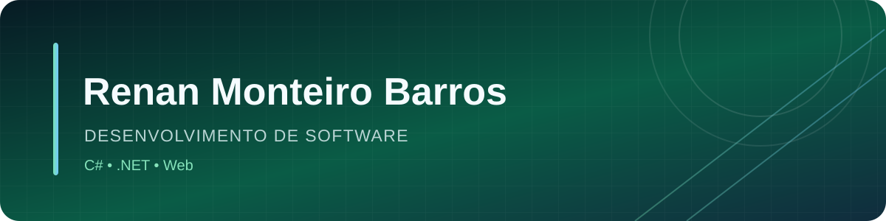

  
   
  
  
  
  

## Olá, sou Renan

Desenvolvedor em formação, interessado em criar aplicações web e projetos em C#/.NET. Aqui compartilho estudos, experiências full-stack e projetos de portfólio.

## Tecnologias presentes nos meus projetos

  
  
  
  
  
  

## Projetos em destaque

| Projeto | Resumo | Tecnologias |
| --- | --- | --- |
| [Hydra Digital Shop](https://github.com/RMBarros-Dev/Hydra-Digital-Shop) | Loja digital de jogos com API e interface web | .NET, React, TypeScript |
| [Instituto Nova Esperança](https://github.com/RMBarros-Dev/instituto-nova-esperanca) | Site institucional multilíngue com recursos PWA | HTML, CSS, JavaScript |
| [Api-Connect](https://github.com/RMBarros-Dev/Api-Connect) | Exemplos de APIs REST em duas stacks | Express, .NET, Aspire |
| [Sistema Bancário](https://github.com/RMBarros-Dev/Sistema-Bancario) | Simulação de operações bancárias em console | C#, .NET, xUnit |
| [Jogo da Adivinhação](https://github.com/RMBarros-Dev/Jogo-da-Adivinha-o) | Jogo de terminal para praticar lógica | C#, .NET |

## Como navegar

Acesse um projeto acima para ver seu README, os requisitos e as instruções de execução. As descrições destacam o propósito e a tecnologia de cada repositório.

  Obrigado por visitar meu perfil.

