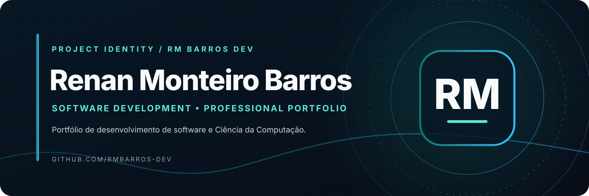
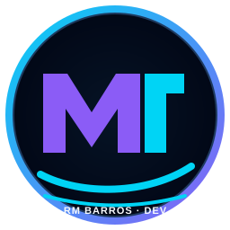
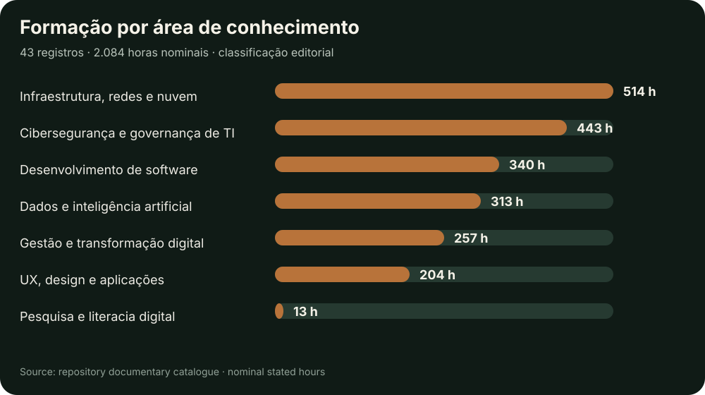
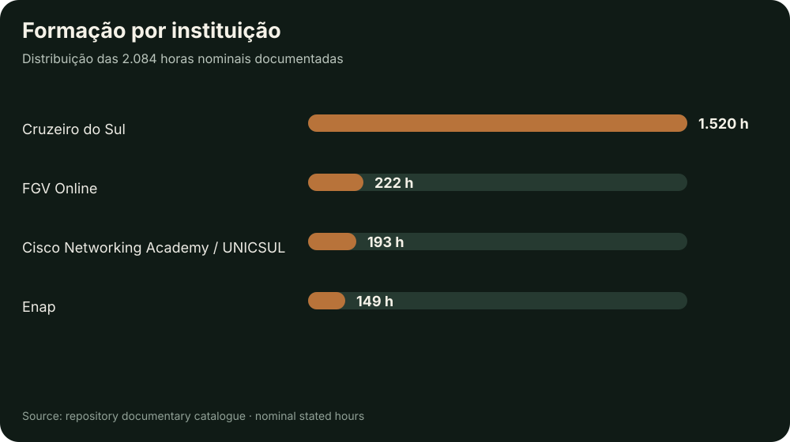

<!--
Perfil profissional e acadêmico de Renan Monteiro Barros.
Atualize este documento quando houver mudanças verificáveis na formação, nos projetos ou nas competências.
-->

  <strong>Idioma:</strong>
  <a href="README.md">Português (Brasil)</a> ·
  <a href="README.en.md">English</a>

  
   
  
  <h1>Renan Monteiro Barros</h1>
  <h3>Ciência da Computação · Desenvolvimento de Software · Engenharia Full Stack</h3>
  

    <a href="https://github.com/RMBarros-Dev">GitHub</a> ·
    <a href="mailto:cienciadacomputacaorenan@gmail.com">E-mail</a>
  

  

    
    
  

  

    
    
    
  

  

    
    
    
    
    
  

---

## Sobre

Sou estudante de **Bacharelado em Ciência da Computação** na Universidade Cruzeiro do Sul e desenvolvedor de software em formação. Meu principal direcionamento é **Engenharia de Software e Desenvolvimento Full Stack**, com interesse na construção de aplicações Web, serviços backend, APIs, integração de sistemas e persistência de dados.

Desenvolvo projetos acadêmicos, pessoais e experimentais para transformar fundamentos de computação em soluções executáveis e documentadas. Tenho interesse complementar em Cibersegurança, Infraestrutura, Ciência de Dados, Inteligência Artificial, UX e tecnologias para transformação digital.

Minha abordagem de desenvolvimento prioriza compreensão do problema, requisitos explícitos, arquitetura proporcional à necessidade, separação de responsabilidades, segurança desde o desenho, testes e documentação. Procuro registrar também as limitações de cada solução, evitando apresentar protótipos como produtos operacionais ou estudos como experiência profissional.

> **Escopo deste perfil:** as informações distinguem projetos efetivamente publicados, tecnologias identificadas nos respectivos repositórios, conteúdos de formação e objetivos de aprendizagem. A presença de uma tecnologia ou área nesta página não implica domínio avançado, certificação profissional ou experiência de trabalho.

## Indicadores de formação e portfólio

  
  
  

Os indicadores abaixo resumem exclusivamente os registros descritos no catálogo documental. As horas são a soma nominal das cargas informadas pelas instituições ou plataformas; não representam experiência profissional, proficiência, horas líquidas únicas ou equivalência entre cursos e trilhas.

**Metodologia de leitura:** cada registro é alocado a uma única área para evitar dupla contagem. A classificação é editorial, baseada nos títulos e conteúdos documentados, e não mede domínio técnico. A natureza de certificados, declarações de participação e trilhas formativas permanece distinta. Consulte o [catálogo completo](docs/certifications.md) para instituições, datas, cargas horárias e critérios documentais.

---

## Áreas de conhecimento

O perfil está organizado em **oito domínios principais** e um eixo transversal de pesquisa e literacia da informação digital. A classificação considera três tipos de evidência: (1) aplicação observável em repositórios; (2) conteúdos identificados em certificados, declarações e trilhas; e (3) formação acadêmica em andamento. Esses níveis não são equivalentes e não devem ser interpretados como comprovação automática de domínio profissional.

<table>
  <tr>
    <td width="50%" valign="top">
      <h3>1. Desenvolvimento e Engenharia de Software</h3>
      
Programação, desenvolvimento ágil, aplicações Full Stack, backend, frontend, APIs REST, integração de serviços, Git/GitHub, testes, qualidade, documentação e manutenção de software.

      
<strong>Evidências:</strong> projetos Hydra Digital Shop, Api-Connect, Olokuti Digital e projetos de fundamentos; formação em programação avançada, desenvolvimento ágil, Git/GitHub, Scrum e Kanban.

    </td>
    <td width="50%" valign="top">
      <h3>2. Infraestrutura, redes e computação em nuvem</h3>
      
Fundamentos de redes, redes Cisco, dispositivos e configuração inicial, administração de redes e servidores, arquiteturas de computação em nuvem e fundamentos de infraestrutura.

      
<strong>Evidências:</strong> trilhas de Administração de Redes e Servidores, Redes Cisco, Arquiteturas de Computação em Nuvem e cursos de configuração e fundamentos de redes.

    </td>
  </tr>
  <tr>
    <td width="50%" valign="top">
      <h3>3. Cibersegurança, perícia e governança de TI</h3>
      
Segurança da informação, codificação segura, gestão de ameaças cibernéticas, proteção de dados, perícia forense computacional, governança de TI, COBIT e ITIL.

      
<strong>Evidências:</strong> trilha de Segurança da Informação e Codificação Segura, Governança de TI com COBIT e ITIL, Perícia Forense Computacional, Gestão de Ameaças e cursos de cibersegurança.

    </td>
    <td width="50%" valign="top">
      <h3>4. Dados, Ciência de Dados e Inteligência Artificial</h3>
      
Armazenamento e gestão de dados, SQL, introdução à Ciência de Dados, linguagem R, fundamentos de álgebra linear aplicada, tópicos de Machine Learning, ética de dados, engenharia de prompts e Big Data aplicado à tomada de decisão.

      
<strong>Evidências:</strong> formações em Ciência de Dados, SQL, armazenamento e gestão de dados, Machine Learning, R, Big Data, ética de dados e IA e Transformação Digital.

    </td>
  </tr>
  <tr>
    <td width="50%" valign="top">
      <h3>5. Gestão, negócios e transformação digital</h3>
      
Conhecimento de negócio, planejamento e governança, gestão municipal, orçamento e finanças públicas, compras, transparência, gestão de riscos, auditoria e tecnologias para transformação digital.

      
<strong>Evidências:</strong> Conhecimento de Negócio, Gestão Municipal: Planejamento e Governança, Novas Tecnologias para a Transformação Digital e Noções Gerais de Auditoria.

    </td>
    <td width="50%" valign="top">
      <h3>6. UX, design e aplicações interativas</h3>
      
Experiência do Usuário, Design Thinking, planejamento visual e gráfico, animação digital, jogos mobile, design instrucional, modelo ADDIE e produção de conteúdo interativo.

      
<strong>Evidências:</strong> projetos e cursos de UX, Design Thinking, Planejamento Visual e Gráfico, Animação Digital, Jogos para Dispositivos Móveis e Design Instrucional.

    </td>
  </tr>
  <tr>
    <td width="50%" valign="top">
      <h3>7. Web, aplicações Mobile e tecnologias emergentes</h3>
      
Interfaces Web, HTML, CSS, JavaScript, TypeScript, React, aplicações PWA e estudos de jogos mobile. Contato curricular com Internet das Coisas (IoT), blockchain e tecnologias disruptivas.

      
<strong>Evidências:</strong> projetos Web e PWA, aplicação React/TypeScript e formação em jogos mobile e tecnologias emergentes.

    </td>
    <td width="50%" valign="top">
      <h3>8. Fundamentos da computação e métodos</h3>
      
Fundamentos de programação, lógica, matemática aplicada, estruturas de dados e sistemas computacionais na graduação; métodos ágeis, Scrum, Kanban e organização de projetos.

      
<strong>Evidências:</strong> formação acadêmica em Ciência da Computação e conteúdos de métodos ágeis documentados em cursos e projetos.

    </td>
  </tr>
</table>

**Eixo transversal — Pesquisa e literacia da informação digital:** mecanismos de pesquisa em ambientes digitais, avaliação e localização de informação. Evidência formativa específica: declaração FGV Online de Mecanismos de Pesquisas em Ambientes Digitais (13 h). Esse registro documenta participação no curso, não uma qualificação formal em pesquisa científica.

**Como interpretar as evidências:** projetos demonstram implementação apenas no escopo efetivamente publicado; certificados e declarações comprovam participação ou conclusão conforme a natureza de cada documento; trilhas representam percursos formativos; conteúdos da graduação refletem formação acadêmica em andamento. IoT e blockchain, por exemplo, aparecem como temas de formação em transformação digital, não como projetos implementados ou especializações declaradas.

## Linguagens e tecnologias

A seleção abaixo prioriza tecnologias verificáveis nos projetos públicos e nos seus respectivos documentos. Não é um ranking de proficiência.

### Ecossistema de tecnologias

  
  
  
  
  

  
  
  
  
  
  
  

> **Leitura das tags:** os selos identificam ecossistemas e tecnologias associados ao portfólio. Não representam níveis de proficiência nem significam que todas as ferramentas estejam integradas em todos os projetos.

### Linguagens identificadas nos projetos

  
  
  
  
  
  
  

### Frameworks, plataformas e ferramentas por contexto

| Categoria | Tecnologias identificadas | Contexto no portfólio |
|---|---|---|
| Backend Python | Django | Olokuti Digital |
| Backend .NET | C#, .NET, ASP.NET Core | Hydra Digital Shop, Api-Connect e projetos de fundamentos |
| Backend JavaScript | Node.js, Express | Api-Connect |
| Frontend | React, TypeScript, Vite | Hydra Digital Shop |
| Interface e estilos | HTML, CSS, Bootstrap, HTMX, Tailwind CSS | Projetos Web correspondentes |
| Persistência | PostgreSQL, SQL Server, SQLite / armazenamento local conforme o projeto | Aplicações e laboratórios |
| Orquestração | .NET Aspire | Hydra Digital Shop e Api-Connect |
| Qualidade | xUnit, pytest, Ruff, CI e CodeQL, conforme os repositórios | Testes e automação nos projetos correspondentes |
| Versionamento | Git e GitHub | Organização e publicação do portfólio |
| Infraestrutura de projeto | Supabase e Railway | Arquitetura documentada do Olokuti Digital |

**Importante:** as tecnologias acima não estão necessariamente presentes em todos os projetos. Consulte o README de cada repositório para identificar versões, dependências, comandos e estado real de implementação. Uma tecnologia documentada como infraestrutura planejada não deve ser interpretada automaticamente como integração ativa em produção.

## Portfólio de projetos

Os projetos abaixo estão organizados em cartões por finalidade, com tecnologias e limites identificados. O detalhamento de escopo, arquitetura, decisões e documentação permanece disponível nas seções expansíveis.

<table>
  <tr>
    <td width="50%" valign="top">
  <h3><a href="https://github.com/RMBarros-Dev/Olokuti-Digital">Olokuti Digital</a></h3>
  
<strong>MVP acadêmico · Catálogo e operações</strong>

  
Aplicação Django concebida para explorar a centralização de informações de produtos, tarefas operacionais, relatórios e eventos de auditoria.

  
  

  
<strong>Limite:</strong> MVP acadêmico e experimental; não é sistema oficial da empresa nem plataforma operacional pronta para produção.

</td>
    <td width="50%" valign="top">
  <h3><a href="https://github.com/RMBarros-Dev/Hydra-Digital-Shop">Hydra Digital Shop</a></h3>
  
<strong>Aplicação Full Stack · Loja digital demonstrativa</strong>

  
Projeto de estudo que integra API ASP.NET Core, interface React/TypeScript e orquestração local com .NET Aspire.

  
  

  
<strong>Limite:</strong> checkout demonstrativo, sem integração com provedor de pagamento real.

</td>
  </tr>
  <tr>
    <td width="50%" valign="top">
  <h3><a href="https://github.com/RMBarros-Dev/instituto-nova-esperanca">Instituto Nova Esperança</a></h3>
  
<strong>Plataforma Web multilíngue · PWA</strong>

  
Site institucional multipágina com conteúdo localizado, recursos de aplicação Web progressiva e rotinas de build e qualidade.

  
  

  
<strong>Limite:</strong> verificações heurísticas de acessibilidade não equivalem a certificação WCAG.

</td>
    <td width="50%" valign="top">
  <h3><a href="https://github.com/RMBarros-Dev/Api-Connect">Api-Connect</a></h3>
  
<strong>Laboratório de APIs · Backend</strong>

  
Trilhas independentes em Node.js/Express e .NET para estudar rotas HTTP, organização backend, contratos e integração.

  
  

  
<strong>Limite:</strong> trilha Express usa armazenamento em memória e não implementa autenticação ou autorização.

</td>
  </tr>
</table>

### Projetos de fundamentos

| Projeto | Escopo | Tecnologias |
|---|---|---|
| [Sistema Bancário](https://github.com/RMBarros-Dev/Sistema-Bancario) | Simulação de operações bancárias, regras de domínio, precisão monetária decimal e persistência local. | C# · .NET · xUnit |
| [Jogo da Adivinhação](https://github.com/RMBarros-Dev/Jogo-da-Adivinha-o) | Lógica de programação, validação de entradas, regras de jogo e testes. | C# · .NET |

### Documentação técnica detalhada

  
<strong>Olokuti Digital — escopo, arquitetura e limites</strong>

   

**MVP acadêmico e experimental · Catálogo e organização operacional**

O Olokuti Digital é um MVP concebido para explorar a centralização de informações de produtos e a organização de atividades operacionais em um contexto de comércio. O projeto investiga fluxos de catálogo, tarefas, relatórios e auditoria, mantendo explícita a diferença entre hipóteses de negócio e requisitos validados.

**Objetivo técnico**
- Organizar informações de catálogo em uma aplicação Web.
- Explorar fluxos de tarefas e acompanhamento operacional.
- Disponibilizar relatórios e exportação de dados.
- Registrar eventos relevantes de auditoria.
- Estruturar a aplicação para internacionalização e localização.

**Arquitetura e tecnologias documentadas**
- Python e Django na camada de aplicação.
- PostgreSQL como banco de dados relacional.
- Supabase como plataforma de hospedagem do PostgreSQL.
- Railway para hospedagem dos componentes de aplicação previstos.
- Templates, componentes de interface e integração HTMX, conforme o escopo documentado.

**Pontos de engenharia**
- Aplicação Django modular.
- Separação de responsabilidades por domínio.
- Controle de acesso por autenticação e permissões.
- Configuração por variáveis de ambiente.
- Testes e integração contínua documentados no repositório.
- Catálogos de tradução e estratégia de localização.

**Limites e transparência**

O projeto é acadêmico e experimental. Não é um sistema oficial da Olokuti, não declara afiliação ou aprovação institucional e não se conecta a sistemas da empresa. Processos, necessidades e benefícios operacionais são hipóteses a validar por investigação de campo. O próprio README do projeto descreve funcionalidades, limites, execução, testes, infraestrutura e segurança.

**Documentação:** [README técnico](https://github.com/RMBarros-Dev/Olokuti-Digital#readme) · [Código-fonte](https://github.com/RMBarros-Dev/Olokuti-Digital)

  
<strong>Hydra Digital Shop — escopo, arquitetura e limites</strong>

   

**Aplicação Full Stack demonstrativa · Comércio digital**

Projeto de estudo que explora a integração de uma API ASP.NET Core com uma interface React e TypeScript. O .NET Aspire é utilizado para coordenar componentes no ambiente de desenvolvimento.

**Escopo documentado**
- Catálogo demonstrativo de jogos.
- Interface Web com páginas de vitrine e detalhes.
- Componentes de biblioteca e carrinho.
- Integração entre frontend e API.
- Endpoint de checkout demonstrativo.
- Orquestração local de serviços com .NET Aspire.

**Tecnologias**
- C# e .NET.
- ASP.NET Core.
- Entity Framework Core.
- React e TypeScript.
- Vite e Tailwind CSS.
- .NET Aspire.
- SQL Server LocalDB na configuração de desenvolvimento documentada.

**Limites:** o checkout é demonstrativo; não integra provedor de pagamento nem movimenta dinheiro real. A configuração local e a persistência descrita no repositório não devem ser tratadas como arquitetura pronta para produção.

**Documentação:** [README técnico](https://github.com/RMBarros-Dev/Hydra-Digital-Shop#readme) · [Código-fonte](https://github.com/RMBarros-Dev/Hydra-Digital-Shop)

  
<strong>Instituto Nova Esperança — escopo e limites</strong>

  

**Plataforma institucional Web · Conteúdo multilíngue e PWA**

Projeto Web institucional com estrutura multipágina, conteúdo localizado e recursos de aplicação Web progressiva.

**Temas técnicos**
- Organização de páginas e conteúdo.
- HTML, CSS e JavaScript.
- Estrutura multilíngue.
- Recursos PWA.
- Scripts de build e verificações de qualidade.

**Limite:** verificações automatizadas ou heurísticas de acessibilidade não equivalem, por si só, a uma certificação de conformidade WCAG. A avaliação deve considerar testes manuais e critérios aplicáveis.

**Documentação:** [Repositório](https://github.com/RMBarros-Dev/instituto-nova-esperanca)

  
<strong>Api-Connect — trilhas, arquitetura e limites</strong>

  

**Laboratório comparativo · APIs HTTP e estruturas backend**

Laboratório que mantém duas trilhas independentes para estudar desenho de APIs e organização backend em ecossistemas distintos.

| Trilha | Componentes | Finalidade |
|---|---|---|
| Node.js | Node.js, Express, rotas, controllers e dados em memória | Exercitar endpoints HTTP e operações CRUD demonstrativas |
| .NET | ASP.NET Core, .NET Aspire, ServiceDefaults e Blazor Web | Explorar serviços e cliente Web no ecossistema .NET |

**Pontos de estudo**
- Métodos HTTP e desenho de rotas.
- Organização por responsabilidades.
- Contratos e payloads JSON.
- Integração cliente/servidor.
- Documentação OpenAPI na trilha .NET.
- Diferenças entre armazenamento em memória e persistência durável.

**Limites:** a trilha Express utiliza dados em memória, que são perdidos ao reiniciar o processo, e não implementa autenticação ou autorização. As trilhas são independentes e não devem ser interpretadas como uma única aplicação híbrida.

**Documentação:** [README técnico](https://github.com/RMBarros-Dev/Api-Connect#readme) · [Código-fonte](https://github.com/RMBarros-Dev/Api-Connect)

  
<strong>Sistema Bancário — fundamentos</strong>

 

**Projeto de fundamentos · Programação e regras de domínio**

Projeto de estudo voltado à modelagem de operações bancárias e à implementação de regras de negócio em uma aplicação de fundamentos.

**Foco de aprendizagem:** organização de código, validação de operações, modelagem de domínio e persistência conforme a implementação do repositório.

  
<strong>Jogo da Adivinhação — fundamentos</strong>

 

**Projeto de fundamentos · Lógica de programação**

Projeto introdutório voltado à prática de lógica, fluxo de execução, interação com o usuário e validação de entradas.

## Como abordo o desenvolvimento de software

Os princípios abaixo orientam as decisões técnicas nos projetos. Eles representam critérios de trabalho, não uma declaração de que todos os repositórios implementam integralmente cada prática.

| Princípio | Como aplico / pretendo aplicar |
|---|---|
| Requirements First | Entender o problema, os usuários, as regras e as restrições antes de selecionar ferramentas. |
| KISS | Preferir soluções simples e legíveis, evitando abstrações sem benefício demonstrável. |
| YAGNI | Não antecipar funcionalidades que não possuem requisito ou justificativa no escopo. |
| Separation of Concerns | Delimitar responsabilidades entre interface, aplicação, domínio, integração e persistência. |
| Security by Design | Considerar autenticação, autorização, validação, segredos e exposição de dados desde o desenho. |
| Testability | Projetar componentes e fluxos que possam ser verificados por testes proporcionais ao risco. |
| Observability | Utilizar logs, estados de saúde e registros úteis sem expor dados sensíveis. |
| Documentation as Code | Manter instruções, decisões, limitações e arquitetura junto ao código. |
| Incremental Delivery | Evoluir em etapas pequenas, verificáveis e compatíveis com os objetivos do projeto. |

### Critérios de qualidade

- **Legibilidade:** nomes claros, estrutura previsível e baixo acoplamento.
- **Manutenibilidade:** mudanças localizadas e responsabilidades bem definidas.
- **Segurança:** menor privilégio, validação de entradas e gestão segura de credenciais.
- **Compatibilidade:** versões e dependências declaradas e verificadas.
- **Reprodutibilidade:** instruções de instalação, configuração e execução.
- **Rastreabilidade:** histórico de alterações, decisões e testes.
- **Honestidade técnica:** separar comportamento implementado, planejamento e limitações conhecidas.

## Formação acadêmica

**Bacharelado em Ciência da Computação — Universidade Cruzeiro do Sul**

- Situação informada: graduação em andamento.

A graduação constitui a base formal de estudos em fundamentos de computação, programação, algoritmos, estruturas de dados, matemática aplicada, bancos de dados e sistemas computacionais. O conteúdo efetivamente cursado deve ser consultado no histórico acadêmico atualizado.

[Informações institucionais do curso](https://cursos.cruzeirodosul.edu.br/grad-ciencia-da-computacao-cruzeiro-do-sul/p)

## Formação complementar e certificados

**41 registros de formação · 1.987 horas nominais documentadas**

O conjunto de registros reúne formações atribuídas à Universidade Cruzeiro do Sul (incluindo Cruzeiro do Sul Virtual), FGV Online, Cisco Networking Academy / UNICSUL, SENAI-SC/LAB365 e Escola Nacional de Administração Pública (Enap).

### Distribuição por área de conhecimento

| Área | Registros | Carga horária nominal |
|---|---:|---:|
| Desenvolvimento e Engenharia de Software | 8 | 340 h |
| Infraestrutura, Redes e Computação em Nuvem | 5 | 514 h |
| Cibersegurança, Perícia e Governança de TI | 7 | 346 h |
| Dados, Ciência de Dados e Inteligência Artificial | 9 | 313 h |
| Gestão, Negócios e Transformação Digital | 4 | 257 h |
| UX, Design e Aplicações Interativas | 7 | 204 h |
| Pesquisa e Literacia da Informação Digital | 1 | 13 h |
| **Total** | **41** | **1.987 h** |

### Cursos e conteúdos representativos

- **Desenvolvimento:** Programação Avançada, Desenvolvimento Ágil de Software, Python Essentials 1, Git e GitHub, HTML e CSS, Scrum e Kanban.
- **Infraestrutura:** Administração de Redes e Servidores, Redes Cisco, Arquiteturas de Computação em Nuvem e configuração de dispositivos de rede.
- **Segurança:** Segurança da Informação e Codificação Segura, Governança de TI com COBIT e ITIL, Perícia Forense Computacional, Gerenciamento de Ameaças Cibernéticas, Proteção de Dados, Sensibilização para a Segurança Digital e Cibersegurança: Anatomia Clássica de um Ciberataque (FGV Online, 9 h).
- **Dados e IA:** Armazenamento e Gestão de Dados, Introdução à Ciência de Dados, SQL, Machine Learning, linguagem R, ética de dados, engenharia de prompts e Big Data em Apoio à Tomada de Decisão.
- **Pesquisa digital:** Mecanismos de Pesquisas em Ambientes Digitais (FGV Online, 13 h).
- **Gestão:** Conhecimento de Negócio, Gestão Municipal, Planejamento, Governança, Auditoria e Novas Tecnologias para Transformação Digital.
- **UX e conteúdo digital:** Animação Digital, Planejamento Visual e Gráfico, Design Thinking, Jogos para Dispositivos Móveis, Design Instrucional e Experiência do Usuário.

**Critério de contabilização:** cada registro foi atribuído a uma única área para evitar dupla contagem na tabela. As 1.987 horas correspondem à soma nominal das cargas horárias declaradas nos documentos; não representam horas líquidas únicas, experiência profissional ou proficiência. Cursos e trilhas podem ter conteúdos relacionados ou sobrepostos. Certificados, declarações de participação e trilhas de aprendizagem devem ser interpretados conforme sua natureza documental.

**Catálogo detalhado:** [Formação complementar e certificados](docs/certifications.md)

## Competências e próximos passos

O desenvolvimento das competências é contínuo e orientado por prática. Os próximos passos estão organizados em eixos que complementam os projetos atuais.

| Eixo | Direção de aprofundamento |
|---|---|
| Arquitetura | Modularidade, contratos, integração, consistência e sistemas distribuídos |
| Backend | APIs, autenticação, autorização, observabilidade e tratamento de falhas |
| Frontend | Acessibilidade, experiência do usuário, estado e testes de interface |
| Dados | Modelagem, índices, transações, migrações e otimização de consultas |
| Qualidade | Testes unitários, integração, ponta a ponta e análise estática |
| Segurança | Modelagem de ameaças, gestão de vulnerabilidades e desenvolvimento seguro |
| Entrega | CI/CD, containers, configuração por ambiente e monitoramento |
| IA e dados | Fundamentos de ML, avaliação de resultados, qualidade e uso responsável |

Esses itens representam direções de aprendizagem e evolução, não funcionalidades que já estejam implementadas em todos os projetos.

## Repositórios e navegação

| Recurso | Finalidade |
|---|---|
| [Todos os repositórios](https://github.com/RMBarros-Dev?tab=repositories) | Consultar o portfólio público completo. |
| [Atividade e contribuições](https://github.com/RMBarros-Dev?tab=overview) | Consultar atividade pública e histórico de contribuições. |
| [Olokuti Digital](https://github.com/RMBarros-Dev/Olokuti-Digital) | Consultar documentação e implementação do MVP. |
| [Hydra Digital Shop](https://github.com/RMBarros-Dev/Hydra-Digital-Shop) | Consultar aplicação Full Stack demonstrativa. |
| [Instituto Nova Esperança](https://github.com/RMBarros-Dev/instituto-nova-esperanca) | Consultar plataforma Web institucional. |
| [Api-Connect](https://github.com/RMBarros-Dev/Api-Connect) | Consultar laboratórios de APIs. |
| [Sistema Bancário](https://github.com/RMBarros-Dev/Sistema-Bancario) | Consultar projeto de fundamentos. |
| [Jogo da Adivinhação](https://github.com/RMBarros-Dev/Jogo-da-Adivinha-o) | Consultar projeto introdutório. |

## Contato

**Renan Monteiro Barros**

- GitHub: [@RMBarros-Dev](https://github.com/RMBarros-Dev)
- E-mail: [cienciadacomputacaorenan@gmail.com](mailto:cienciadacomputacaorenan@gmail.com)

Para assuntos técnicos, projetos e colaboração, utilize os canais públicos acima.

---

  
  <h3>Construindo conhecimento. Projetando soluções. Evoluindo continuamente.</h3>
  Ciência da Computação · Desenvolvimento de Software · Engenharia

