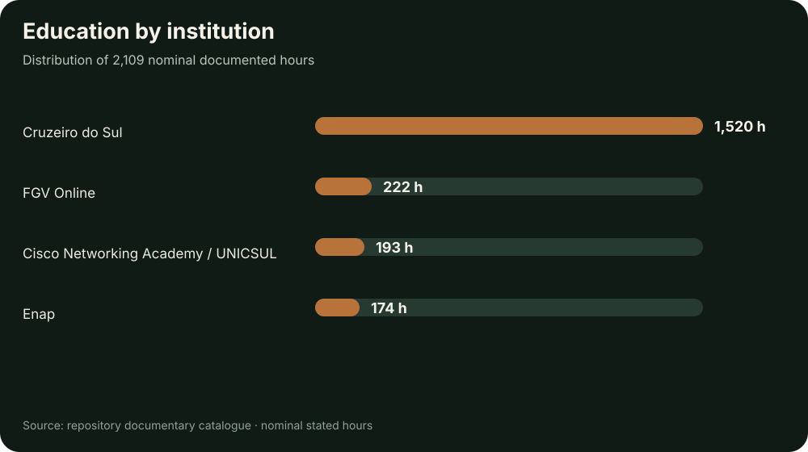

<!--
Professional and academic profile.
Update this document only when education, projects or skills can be verified.
-->

  <strong>Languages:</strong>
  <a href="README.md">English</a> ·
  <a href="README.es.md">Español</a> ·
  <a href="README.pt-BR.md">Português (Brasil)</a>

  
   
  
  <h1>Renan Monteiro Barros</h1>
  <h3>Computer Science · Software Development · Full-Stack Engineering</h3>
  
<a href="https://github.com/RMBarros-Dev">GitHub</a> · <a href="mailto:cienciadacomputacaorenan@gmail.com">Email</a>

  

    
    
  

  

    
    
    
  

---

## 01 · About Me

I am an undergraduate **Computer Science student at Universidade Cruzeiro do Sul**, currently developing my foundations as a software developer. My primary direction is **Software Engineering and Full-Stack Development**, with an interest in Web applications, backend services, APIs, system integration and data persistence.

I build academic, personal and experimental projects to turn computing fundamentals into executable and documented solutions. Complementary interests include cybersecurity, infrastructure, data science, artificial intelligence, UX and technologies for digital transformation.

My approach prioritises understanding the problem, explicit requirements, proportionate architecture, separation of concerns, security by design, testing and documentation. I also document limitations so that prototypes are not presented as operational products and coursework is not misrepresented as professional experience.

> **Profile scope:** this page distinguishes published implementations, technologies identified in repositories, documented education and learning goals. Mentioning a technology or subject does not imply advanced proficiency, professional certification or employment experience.

## 02 · Academic Summary

  
  
  

The indicators summarise the documentary records listed in the complementary education catalogue. Workload is the sum of hours stated by institutions or learning platforms; it is not professional experience, proficiency, unique net study time or an equivalence between courses and learning tracks.

**Counting methodology:** each record is assigned to one area to avoid double counting in the summary. Classification is editorial and based on documented titles and content; it does not measure technical proficiency. Certificates, participation statements and learning tracks retain their distinct documentary nature. See the [full education catalogue](docs/certifications.en.md) for institutions, dates, workloads and evidence criteria.

## 03 · Academic Vision

My academic direction connects computer science foundations with practical software engineering. The goal is to develop the ability to analyse requirements, make justified technical decisions, implement maintainable systems and validate their behaviour.

The current learning focus is organised around:
- Software engineering and full-stack application development.
- Backend architecture, API design and system integration.
- Databases, data modelling and persistence.
- Software quality, automated testing and continuous integration.
- Application security, infrastructure and cloud fundamentals.
- Data science and AI foundations, with responsible use and evaluation.
- UX, accessibility and multilingual digital experiences.

These are study and improvement directions, not claims that every topic is already implemented in the portfolio.

## 04 · Projects Grid

The projects below are presented by purpose, with technologies and limitations made explicit. Consult each repository for implementation details, versions, setup instructions and current status.

<table>
  <tr>
    <td width="50%" valign="top">
      <h3><a href="https://github.com/RMBarros-Dev/Hydra-Digital-Shop">Hydra Digital Shop</a></h3>
      
<strong>Full-Stack demonstrator · Digital commerce</strong>

      
Study project integrating an ASP.NET Core API, React/TypeScript interface and local orchestration with .NET Aspire.

      
  

      
<strong>Limit:</strong> demonstrative checkout; no real payment-provider integration.

    </td>
    <td width="50%" valign="top">
      <h3><a href="https://github.com/RMBarros-Dev/Olokuti-Digital">Olokuti Digital</a></h3>
      
<strong>Academic MVP · Product catalogue and operations</strong>

      
Django application concept exploring centralised product information, operational tasks, reporting and audit events.

      
  

      
<strong>Limit:</strong> academic and experimental MVP; not an official company system or production deployment.

    </td>
  </tr>
  <tr>
    <td width="50%" valign="top">
      <h3><a href="https://github.com/RMBarros-Dev/Api-Connect">Api-Connect</a></h3>
      
<strong>API laboratory · Backend</strong>

      
Independent Node.js/Express and .NET tracks for studying HTTP routes, backend organisation, contracts and integration.

      
  

      
<strong>Limit:</strong> the Express track uses in-memory storage and has no authentication or authorisation.

    </td>
    <td width="50%" valign="top">
      <h3><a href="https://github.com/RMBarros-Dev/instituto-nova-esperanca">Instituto Nova Esperança</a></h3>
      
<strong>Multilingual Web platform · PWA</strong>

      
Multi-page institutional website with localised content, progressive Web app resources and quality workflows.

      
  

      
<strong>Limit:</strong> heuristic accessibility checks do not constitute WCAG certification.

    </td>
  </tr>
</table>

### Foundational projects

| Repository | Scope | Technologies |
|---|---|---|
| [Sistema Bancário](https://github.com/RMBarros-Dev/Sistema-Bancario) | Banking-operation simulation, domain rules, decimal monetary precision and local persistence. | C# · .NET · xUnit |
| [Jogo da Adivinhação](https://github.com/RMBarros-Dev/Jogo-da-Adivinha-o) | Programming logic, input validation, game rules and testable flow. | C# · .NET |

## 05 · Badges, Tags & Language Logos

The badges below identify technologies associated with the portfolio. They are not proficiency rankings and do not mean that every tool is used in every repository.

### Languages

  
  
  
  
  
  
  

### Frameworks, platforms and tools

  
  
  
  
  
  

| Category | Technologies identified | Portfolio context |
|---|---|---|
| Python backend | Django | Olokuti Digital |
| .NET backend | C#, .NET, ASP.NET Core | Hydra Digital Shop, Api-Connect and foundational projects |
| JavaScript backend | Node.js, Express | Api-Connect |
| Frontend | React, TypeScript, Vite | Hydra Digital Shop |
| Interface and styling | HTML, CSS, Bootstrap, HTMX, Tailwind CSS | Relevant Web projects |
| Persistence | PostgreSQL, SQL Server, SQLite / local storage depending on project | Applications and labs |
| Orchestration | .NET Aspire | Hydra Digital Shop and Api-Connect |
| Quality | xUnit, pytest, Ruff, CI and CodeQL, according to each repository | Tests and automation in corresponding projects |
| Version control | Git and GitHub | Portfolio organisation and publication |
| Project infrastructure | Supabase and Railway | Documented Olokuti Digital architecture |

Technology listed as planned infrastructure must not automatically be interpreted as an active production integration. Check each repository README for exact versions, dependencies and implementation status.

## 06 · Methodology

The following principles guide technical decisions. They are working criteria, not a claim that every repository fully implements every practice.

| Principle | Application |
|---|---|
| Requirements First | Understand the problem, users, rules and constraints before selecting tools. |
| KISS | Prefer simple, readable solutions and avoid abstractions without demonstrated value. |
| YAGNI | Do not anticipate features without a requirement or scope justification. |
| Separation of Concerns | Define boundaries between interface, application, domain, integration and persistence. |
| Security by Design | Consider authentication, authorisation, validation, secrets and data exposure from the design stage. |
| Testability | Build components and flows that can be verified with tests proportional to risk. |
| Observability | Use useful logs and health signals without exposing sensitive information. |
| Documentation as Code | Keep setup, decisions, limitations and architecture alongside the code. |
| Incremental Delivery | Evolve through small, verifiable steps. |

Quality criteria include readability, maintainability, secure configuration, compatibility, reproducibility, traceability and technical honesty.

## 07 · Structure, Architecture & Version Control

My architecture approach starts with requirements and project constraints. I aim to keep responsibilities explicit and complexity proportional to the problem.

- **Structure:** organise code by responsibility and domain; avoid unnecessary coupling.
- **Architecture:** distinguish interface, application logic, domain rules, integrations and persistence where the project scope justifies it.
- **Configuration:** keep environment-specific settings outside source code and protect credentials.
- **Data:** document schemas, persistence assumptions and migration requirements.
- **Version control:** use Git and GitHub to track changes, review history and document meaningful decisions.
- **Documentation:** maintain setup instructions, architecture notes, limitations and project status.

Repository-specific architecture and version-control conventions are documented in each project's README and engineering files. Planned designs are not presented as completed deployments.

## 08 · Automation, Testing & Applications

Automation and testing are applied according to each project's stack and maturity.

| Area | Tools or practices identified | Purpose |
|---|---|---|
| Automated tests | xUnit, pytest | Verify business rules and application behaviour where configured |
| Static analysis | Ruff and repository-specific analyzers | Detect selected code-quality issues |
| CI | GitHub Actions | Automate repository workflows and validation |
| Security analysis | CodeQL where configured | Static security analysis |
| Build and orchestration | .NET Aspire, project scripts | Support local development and service coordination |
| Web application delivery | Build scripts and PWA resources in relevant projects | Produce and validate Web assets |

The existence of a workflow or badge is not proof that every test passes at all times. Check the live Actions status and repository instructions for current results.

## 09 · Technologies, Security & Governance

Security is treated as an engineering concern, not as a decorative badge or unsupported certification claim.

Core principles:
- Validate input and handle errors deliberately.
- Protect credentials with environment configuration and secret-management practices.
- Apply least privilege to identities and services.
- Separate authentication from authorisation.
- Avoid logging secrets and sensitive personal data.
- Keep dependencies and runtime versions documented.
- Consider privacy, data minimisation and retention.
- Record limitations and unresolved risks transparently.

Governance and security topics in the education catalogue include information security, secure coding, cyber-threat management, data protection, computer forensics, IT governance, COBIT and ITIL. These are documented learning subjects, not a claim of professional certification or security-audit authority.

## 10 · Tables, Charts & Statistics

### Complementary education by knowledge area

| Area | Records | Nominal hours |
|---|---:|---:|
| Software Development and Engineering | 8 | 340 h |
| Infrastructure, Networks and Cloud | 5 | 514 h |
| Cybersecurity, Forensics and IT Governance | 7 | 346 h |
| Data, Data Science and Artificial Intelligence | 9 | 313 h |
| Management, Business and Digital Transformation | 4 | 257 h |
| UX, Design and Interactive Applications | 7 | 204 h |
| Digital Research and Information Literacy | 1 | 13 h |
| **Total** | **41** | **1,987 h** |

### Education by institution

| Institution / provider | Records | Nominal hours |
|---|---:|---:|
| Universidade Cruzeiro do Sul (including Cruzeiro do Sul Virtual) | 14 | 1,520 h |
| FGV Online | 17 | 222 h |
| Cisco Networking Academy / UNICSUL and SENAI-SC/LAB365 | 5 | 96 h |
| Escola Nacional de Administração Pública (Enap) | 5 | 149 h |
| **Total** | **41** | **1,987 h** |

**Methodological note:** the figures are nominal workloads transcribed from the catalogue's source records. They are not unique net study time, work experience or a measure of proficiency. The detailed catalogue distinguishes certificates, participation statements and learning tracks.

## 11 · University Academic Education

**Bachelor's Degree in Computer Science — Universidade Cruzeiro do Sul**

- Status recorded: undergraduate studies in progress.

The degree provides the formal academic foundation for studying computing fundamentals, programming, algorithms, data structures, applied mathematics, databases and computer systems. The subjects actually completed should be confirmed against the current academic transcript.

[University course information](https://cursos.cruzeirodosul.edu.br/grad-ciencia-da-computacao-cruzeiro-do-sul/p)

## 12 · Complementary Academic Education

**41 education records · 1,987 documented nominal hours**

The catalogue includes records attributed to Universidade Cruzeiro do Sul (including Cruzeiro do Sul Virtual), FGV Online, Cisco Networking Academy / UNICSUL, SENAI-SC/LAB365 and Escola Nacional de Administração Pública (Enap).

Representative subjects include:
- **Software development:** Advanced Programming, Agile Software Development, Python Essentials 1, Git and GitHub, HTML and CSS, Scrum and Kanban.
- **Infrastructure:** Network and Server Administration, Cisco Networking, Cloud Computing Architectures and network-device configuration.
- **Security:** Information Security and Secure Coding, IT Governance with COBIT and ITIL, Computer Forensics, Cyber Threat Management, Data Protection and cybersecurity awareness.
- **Data and AI:** Data Storage and Management, Introduction to Data Science, SQL, Machine Learning, R, data ethics, prompt engineering and Big Data for decision-making.
- **Digital research:** Search Mechanisms in Digital Environments (FGV Online, 13 h).
- **Management:** Business Knowledge, Municipal Management, Planning, Governance, Auditing and New Technologies for Digital Transformation.
- **UX and digital content:** Digital Animation, Visual and Graphic Planning, Design Thinking, Mobile Games, Instructional Design and User Experience.

**Accounting criteria:** each record is assigned to one area to avoid double counting. The 1,987 hours are the sum of nominal workloads stated in the documents; they are not unique net hours, professional experience or proficiency. Courses and learning tracks may have related or overlapping content. Certificates, participation statements and learning tracks must be interpreted according to their documentary type.

[Detailed complementary education catalogue](docs/certifications.en.md)

## 13 · Improvement Roadmap

The following topics are development goals and learning directions, not features already implemented across all projects.

| Track | Improvement direction |
|---|---|
| Architecture | Modularity, contracts, integration, consistency and distributed systems |
| Backend | APIs, authentication, authorisation, observability and failure handling |
| Frontend | Accessibility, UX, state management and interface testing |
| Data | Modelling, indexes, transactions, migrations and query optimisation |
| Quality | Unit, integration and end-to-end testing; static analysis |
| Security | Threat modelling, vulnerability management and secure development |
| Delivery | CI/CD, deployment environments, configuration and monitoring |
| AI and data | ML foundations, evaluation, data quality and responsible use |

## 14 · Applications, References & Repository Navigation

| Resource | Purpose |
|---|---|
| [All repositories](https://github.com/RMBarros-Dev?tab=repositories) | Browse the public portfolio |
| [Profile activity](https://github.com/RMBarros-Dev?tab=overview) | View public activity and contributions |
| [Olokuti Digital](https://github.com/RMBarros-Dev/Olokuti-Digital) | Academic MVP documentation and implementation |
| [Hydra Digital Shop](https://github.com/RMBarros-Dev/Hydra-Digital-Shop) | Full-Stack demonstrator |
| [Instituto Nova Esperança](https://github.com/RMBarros-Dev/instituto-nova-esperanca) | Multilingual Web platform |
| [Api-Connect](https://github.com/RMBarros-Dev/Api-Connect) | API laboratories |
| [Sistema Bancário](https://github.com/RMBarros-Dev/Sistema-Bancario) | Foundational project |
| [Jogo da Adivinhação](https://github.com/RMBarros-Dev/Jogo-da-Adivinha-o) | Introductory project |

## 15 · Acknowledgements

I acknowledge the universities, educational institutions, instructors, open-source communities and developers whose courses, documentation and tools contribute to my learning. I also value the people who review projects, report issues and share technical knowledge.

  
  <h3>Learning continuously. Engineering thoughtfully. Building with purpose.</h3>
  Computer Science · Software Development · Engineering
  
<a href="mailto:cienciadacomputacaorenan@gmail.com">Contact</a> · <a href="https://github.com/RMBarros-Dev">GitHub</a>

