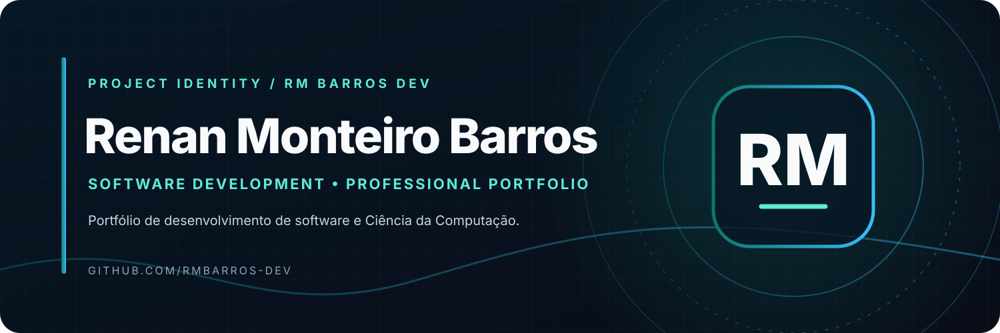
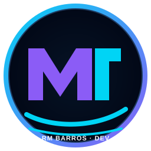
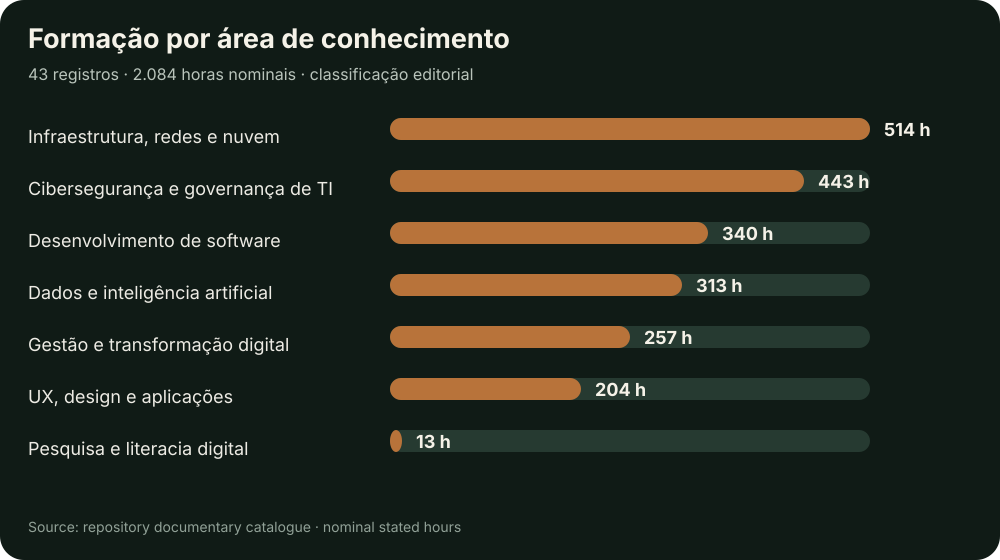
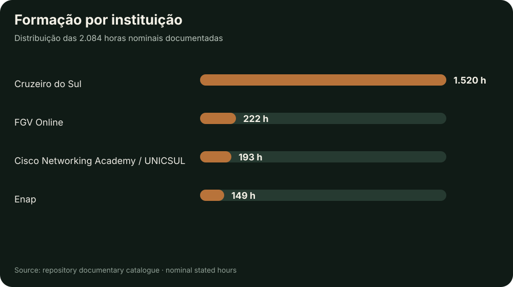

<!-- Português brasileiro: idioma secundário. English é o idioma principal. -->

<strong>Idiomas:</strong> <a href="README.md">English</a> · <a href="README.es.md">Español</a> · <a href="README.pt-BR.md">Português (Brasil)</a>

  
   
  
  <h1>Renan Monteiro Barros</h1>
  <h3>Estudante de Ciência da Computação · Desenvolvimento de Software · Engenharia Full Stack</h3>
  
<a href="https://github.com/RMBarros-Dev">GitHub</a> · <a href="mailto:cienciadacomputacaorenan@gmail.com">E-mail</a>

---

## 01 · Sobre mim

Sou **Renan Monteiro Barros**, estudante de graduação em **Ciência da Computação na Universidade Cruzeiro do Sul**. Minha direção técnica é **Desenvolvimento Full Stack e Engenharia de Software**, com interesse em backend, APIs, aplicações web, bancos de dados, integração de sistemas e qualidade de software.

Desenvolvo projetos acadêmicos, pessoais e experimentais para aplicar fundamentos da computação, praticar resolução de problemas e documentar decisões técnicas. Valorizo requisitos claros, código sustentável, arquitetura proporcional ao problema, configuração segura, testes e documentação honesta. Diferencio funcionalidades implementadas de melhorias previstas e aprendizagem de experiência profissional.

## 02 · Resumo acadêmico

  
  

O catálogo de formação complementar reúne **41 registros educacionais e 1.987 horas nominais**, conforme as cargas horárias informadas pelas instituições ou plataformas. Inclui certificados, declarações de participação e trilhas de aprendizagem, que são tipos de registro distintos.

Horas nominais não representam experiência profissional, tempo líquido único de estudo ou nível de proficiência. Consulte o [catálogo detalhado](docs/certifications.md).

### Linguagens e tecnologias na minha trajetória de aprendizagem

  
  
  
  

| Grupo | Tecnologias | Quantidade |
|---|---|---:|
| Programação e scripting | Python, C, C++, C#, Java, JavaScript, TypeScript, PHP, Go, Kotlin, Dart, Swift, Rust, Bash | **14** |
| Marcação e estilos | HTML, CSS | **2** |
| Consultas | SQL | **1** |
| **Total** | **17 tecnologias distintas** | **17** |

Esses números representam tecnologias que estudei ou utilizei, conforme minha trajetória de aprendizagem. Não indicam frequência de uso, nível de proficiência, experiência profissional nem quantidade de código nos repositórios. As estatísticas de cada repositório serão medidas separadamente, com base no código-fonte de cada um.

## 03 · Visão acadêmica

Busco conectar fundamentos da computação à engenharia aplicada e aprimorar minha capacidade de analisar problemas, modelar soluções, justificar decisões, construir aplicações sustentáveis e verificar seu comportamento.

Frentes de desenvolvimento:
- Engenharia de Software, algoritmos e programação.
- Desenvolvimento Full Stack e design de APIs.
- Bancos de dados, persistência e gestão de dados.
- Arquitetura, testes e integração contínua.
- Segurança de aplicações, infraestrutura e cloud.
- Ciência de Dados e Inteligência Artificial.
- UX, acessibilidade, internacionalização e localização.

São prioridades de aprendizagem, não afirmações de domínio completo.

## 04 · Projetos em grade

<table>
  <tr>
    <td width="50%" valign="top">
      <h3><a href="https://github.com/RMBarros-Dev/Hydra-Digital-Shop">Hydra Digital Shop</a></h3>
      
<strong>Demonstrador de comércio Full Stack</strong>

      
Projeto de estudo com backend ASP.NET Core, interface React/TypeScript e orquestração .NET Aspire.

      
  

      
<em>Escopo: checkout demonstrativo, sem provedor real de pagamentos.</em>

    </td>
    <td width="50%" valign="top">
      <h3><a href="https://github.com/RMBarros-Dev/Olokuti-Digital">Olokuti Digital</a></h3>
      
<strong>MVP acadêmico · Produtos e operações</strong>

      
Conceito para centralizar informações de produtos, estoque e atividades operacionais.

      
  

      
<em>Escopo: MVP acadêmico e experimental, não é um sistema em produção.</em>

    </td>
  </tr>
  <tr>
    <td width="50%" valign="top">
      <h3><a href="https://github.com/RMBarros-Dev/Api-Connect">Api-Connect</a></h3>
      
<strong>Laboratório backend e APIs</strong>

      
Frentes independentes Node.js/Express e .NET para praticar endpoints HTTP e integração.

      
  

      
<em>Escopo: a frente Express usa armazenamento em memória e não inclui autenticação ou autorização.</em>

    </td>
    <td width="50%" valign="top">
      <h3><a href="https://github.com/RMBarros-Dev/instituto-nova-esperanca">Instituto Nova Esperança</a></h3>
      
<strong>Web multilíngue · PWA</strong>

      
Experiência institucional com conteúdo localizado, interface responsiva e recursos PWA.

      
  

      
<em>Escopo: verificações de acessibilidade não equivalem a uma certificação WCAG.</em>

    </td>
  </tr>
  <tr>
    <td width="50%" valign="top">
      <h3><a href="https://github.com/RMBarros-Dev/Sistema-Bancario">Sistema Bancário</a></h3>
      
<strong>Simulação de lógica bancária</strong>

      
Projeto educacional em C# sobre operações, regras de negócio e fundamentos de persistência.

      
 

    </td>
    <td width="50%" valign="top">
      <h3><a href="https://github.com/RMBarros-Dev/Jogo-da-Adivinha-o">Jogo da Adivinhação</a></h3>
      
<strong>Fundamentos de programação</strong>

      
Aplicação de console para praticar lógica, condições e validação de entradas.

      
 

    </td>
  </tr>
</table>

## 05 · Badges, tags e logos de linguagens

Os badges identificam tecnologias presentes na minha trajetória de aprendizagem ou nos repositórios. Não indicam níveis de proficiência nem certificações.

  
  
  
  
  
  
  

Ferramentas e plataformas: .NET, ASP.NET Core, Django, Node.js, Express, React, PostgreSQL, Git e GitHub. Outras linguagens estudadas ou utilizadas: C, C++, Java, PHP, Go, Kotlin, Dart, Swift, Rust e Bash. A menção não implica igual profundidade ou uso atual em todos os projetos.

## 06 · Metodologia

| Princípio | Aplicação |
|---|---|
| Requirements First | Compreender problema, usuários, restrições e critérios de aceite. |
| KISS | Preferir soluções simples e suficientes. |
| YAGNI | Evitar funcionalidades especulativas e abstrações desnecessárias. |
| Separation of Concerns | Separar responsabilidades e limites. |
| SOLID | Aplicar princípios de design quando agregarem coesão e manutenibilidade. |
| Security by Design | Considerar validação, acessos, segredos e exposição de dados desde o design. |
| Testability | Facilitar a verificação de comportamentos. |
| Documentation as Code | Versionar decisões, instruções e limitações. |
| Incremental Delivery | Entregar mudanças pequenas e verificáveis. |

## 07 · Estrutura, arquitetura e versionamento

- **Estrutura:** módulos organizados por responsabilidade e domínio.
- **Arquitetura:** separar apresentação, lógica, domínio, integrações e persistência quando justificado.
- **Dados:** documentar entidades, relacionamentos, restrições e migrações.
- **Configuração:** manter variáveis de ambiente fora do código e proteger credenciais.
- **Versionamento:** Git para histórico; GitHub para colaboração, revisão e publicação.
- **Mudanças:** commits objetivos e pull requests revisáveis.
- **Documentação:** instalação, decisões, dependências, limitações e situação.

A documentação de cada repositório descreve sua implementação real. Arquiteturas planejadas não são apresentadas como implantações concluídas.

## 08 · Automação, testes e aplicações

| Área | Ferramentas / práticas | Finalidade |
|---|---|---|
| Testes | xUnit, pytest | Verificar comportamentos e regras. |
| Análise estática | Ruff e analisadores específicos | Detectar problemas selecionados de qualidade. |
| CI | GitHub Actions | Automatizar verificações. |
| Segurança | CodeQL quando configurado | Analisar padrões de risco no código. |
| Build e orquestração | .NET Aspire e scripts | Apoiar desenvolvimento e coordenação local. |
| Web | Scripts de build e recursos PWA | Construir e validar recursos web. |

Um workflow ou badge não garante que todos os testes estejam aprovados em qualquer momento. Os resultados atuais devem ser consultados no histórico de Actions.

## 09 · Tecnologias, segurança e governança

- Validação de entradas e tratamento de erros.
- Separação entre autenticação e autorização.
- Princípio do menor privilégio.
- Proteção de segredos e credenciais.
- Minimização e cuidado com dados pessoais.
- Manutenção de dependências e configurações.
- Logs úteis sem exposição de informações sensíveis.
- Documentação de riscos e limitações.

A formação complementar inclui segurança da informação, programação segura, cibersegurança, perícia computacional, proteção de dados, governança de TI, COBIT e ITIL. São temas de estudo, não certificações profissionais de auditoria ou segurança.

## 10 · Tabelas, gráficos e estatísticas

### Formação por área

| Área | Registros | Horas nominais |
|---|---:|---:|
| Desenvolvimento e Engenharia de Software | 8 | 340 h |
| Infraestrutura, Redes e Cloud | 5 | 514 h |
| Cibersegurança, Perícia e Governança de TI | 7 | 346 h |
| Dados, Ciência de Dados e Inteligência Artificial | 9 | 313 h |
| Gestão, Negócios e Transformação Digital | 4 | 257 h |
| UX, Design e Aplicações Interativas | 7 | 204 h |
| Pesquisa Digital e Letramento Informacional | 1 | 13 h |
| **Total** | **41** | **1.987 h** |

### Formação por instituição

| Instituição / provedora | Registros | Horas nominais |
|---|---:|---:|
| Universidade Cruzeiro do Sul (inclui Cruzeiro do Sul Virtual) | 14 | 1.520 h |
| FGV Online | 17 | 222 h |
| Cisco Networking Academy / UNICSUL e SENAI-SC/LAB365 | 5 | 96 h |
| Escola Nacional de Administração Pública (Enap) | 5 | 149 h |
| **Total** | **41** | **1.987 h** |

Cada registro é atribuído a uma área principal para evitar duplicidade no resumo. As horas são cargas nominais transcritas do catálogo e não medem competências. Consulte o [catálogo](docs/certifications.md).

## 11 · Formação acadêmica universitária

### Bacharelado em Ciência da Computação
**Universidade Cruzeiro do Sul · Graduação em andamento**

O curso constitui a base acadêmica formal da minha formação. Disciplinas cursadas, créditos concluídos e progresso devem ser confirmados pelo histórico oficial; este perfil não presume matérias concluídas nem graduação.

[Universidade Cruzeiro do Sul — Ciência da Computação](https://cursos.cruzeirodosul.edu.br/grad-ciencia-da-computacao-cruzeiro-do-sul/p)

## 12 · Formação acadêmica complementar

O catálogo documenta **41 registros e 1.987 horas nominais** da Universidade Cruzeiro do Sul / Cruzeiro do Sul Virtual, FGV Online, Cisco Networking Academy / UNICSUL, SENAI-SC/LAB365 e Enap.

Temas:
- Desenvolvimento de software, programação, Python, Git, tecnologias web e métodos ágeis.
- Redes, administração de servidores e cloud.
- Segurança da informação, programação segura, cibersegurança, perícia computacional e proteção de dados.
- Dados, SQL, Ciência de Dados, Machine Learning, R e temas de IA.
- Negócios, gestão, governança e transformação digital.
- UX, design, conteúdo digital e design instrucional.
- Pesquisa digital e letramento informacional.

O catálogo diferencia certificados, declarações de participação e trilhas de aprendizagem. Consulte [Registros de formação complementar](docs/certifications.md).

## 13 · Visões de aperfeiçoamento

Estas são prioridades de aprendizagem, não alegações de certificações obtidas ou capacidades produtivas já implementadas.

| Eixo | Direção de aperfeiçoamento |
|---|---|
| Fundamentos da Computação | Fortalecer algoritmos, estruturas de dados e resolução de problemas. |
| Engenharia de Software | Aprimorar requisitos, modelagem de domínio e manutenibilidade. |
| Full Stack | Criar aplicações completas com contratos claros entre frontend e backend. |
| Arquitetura e APIs | Aprofundar integração, resiliência e observabilidade. |
| Bancos de dados | Melhorar modelagem, transações, índices e consultas. |
| Qualidade | Ampliar testes automatizados e prevenção de regressões. |
| Segurança | Praticar análise de ameaças, código seguro e privacidade. |
| Cloud e infraestrutura | Evoluir em implantação, configuração e monitoramento. |
| Dados e IA | Desenvolver avaliação de dados e fundamentos de IA responsável. |
| Acessibilidade e localização | Melhorar interfaces inclusivas e internacionalização. |

## 14 · Agradecimentos

Agradeço a educadores, instituições, comunidades técnicas, mantenedores de projetos open source e colaboradores que contribuem para a aprendizagem contínua e para este portfólio.

Agradecimento especial à **Universidade Cruzeiro do Sul**, às instituições de formação complementar listadas no catálogo e a todas as pessoas que compartilham conhecimento, revisam código e promovem o desenvolvimento responsável de software.

---

Construído com curiosidade, disciplina de engenharia e aprendizagem contínua.

